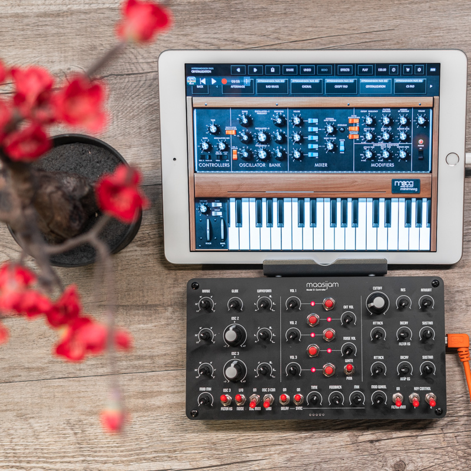

# model_d_controller
Teensy LC based USB Midi-Controller for the Moog Model D App (and of course all other USB-MIDI devices)
 
> [!NOTE]
> The Teensy LC is no longer available. With a few modifications, you can also use a Teensy 4. But that's quite expensive. Here's a fork which supports now either an ESP32 H2 DevKitM, a Raspberry Pico or a Waveshare Zero RP2040: https://github.com/mgsg/20pi

 

Disclaimer: This is a DIY project. Use at your own risk.

The controller in action (YouTube links)

